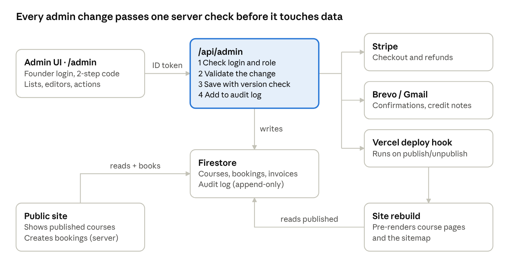
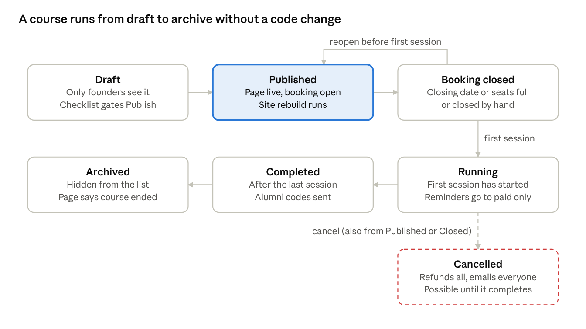
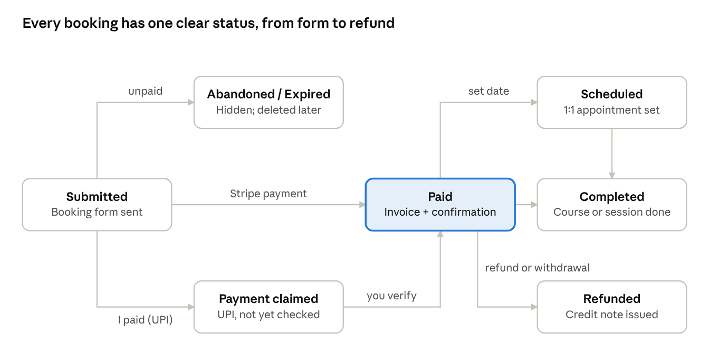

# Niramay Admin Section — Design

Oct 30, 2026 · Riju Kansal · Decisions recorded Nov 1, 2026

> Living version (with comments): https://claude.ai/artifact/WWVqHGybdwnZqmrRaEtxzG — this file is a snapshot for the repo.

## Summary

Build one admin area at **/admin**, behind the two founder logins, that takes over from today's /write page. Build two modules first: **Courses & Schedule** and **Bookings & Payments**. Today these are the parts of the site that can only be changed in code or seen in the Firebase console.

- **Priority 1, Courses & Schedule.** A new course currently means hand-editing 5 files and redeploying (`src/constants.ts`, `api/_lib/courses.ts`, `firestore.rules`, `api/sitemap.ts`, the page copy in `TRANSLATIONS`). Courses become database records that you create, translate, publish, reschedule and cancel yourselves.
- **Priority 2, Bookings & Payments.** Five kinds of booking (courses, Reiki, astrology/guidance, tarot, payment links) currently exist only as emails and Firestore documents. They become one inbox with clear statuses, UPI verification, refunds with credit notes, an invoice ledger for your tax adviser, and better payment links.
- **Everything else** (reviews, comments, discounts, newsletter, services and prices, the events gallery, FAQs, settings) is listed with a short outline, to be detailed later.

Four decisions shape the build:

1. **Every admin change goes through the server.** The admin screens never write to Firestore directly. One server endpoint checks the login, validates the change, writes it with the admin SDK and records it in an audit log. This is the same pattern the payment links already use.
2. **Site content stays fast and findable.** Course pages read the database live, and **Publish** also starts a site rebuild, so Google keeps getting fully pre-rendered pages.
3. **Bookings are created on the server.** Today the browser creates bookings and the Firestore rules hard-code the course ids and dates. Moving this to the server lets new courses work without a rules change, and lets the server enforce closing dates and seat limits.
4. **Before charging real customers, move the Vercel project from Hobby to Pro.** Vercel limits Hobby to non-commercial, personal use. Pro also lifts the 12-function and once-a-day cron limits the code currently works around ([Vercel Hobby plan](https://vercel.com/docs/plans/hobby)). *(Decision, Nov 1: stay on Hobby until the first few paid registrations, then move — see Rollout.)*

## Current state of the app

Only blog posts have a real admin today. Almost everything else is changed by editing code, or checked in emails and the Firebase console.

The app is a React/Vite single-page site with Vercel serverless functions. It uses Firestore and Firebase Auth for data and logins, Vercel Blob for media, Stripe Checkout for EUR payments, manual UPI for INR, Brevo for the newsletter, Gmail SMTP for transactional email and DeepL for translation. The pages are pre-rendered at build time for SEO.

| Area | Where it lives today | How it changes today |
| --- | --- | --- |
| Blog posts | Firestore `blogs`, `blogReviews`, approvals log | /write: drafts, four-eyes approval, typo-fix log, DeepL translation, newsletter announcement. This already works well |
| Payment links | Firestore `paymentRequests` | /write panel: create and list only. No cancel, resend or extend |
| Courses | `COURSES` in `src/constants.ts` **and** `api/_lib/courses.ts`, plus course and session ids in `firestore.rules`, `COURSE_IDS` in `api/sitemap.ts`, page copy in `TRANSLATIONS`, `ANNOUNCEMENTS` banner | Code change and deploy, keeping 5–6 places in sync by hand |
| 1:1 service prices (Reiki, astrology, guidance, tarot) | `TRANSLATIONS` text **and** `api/_lib/servicePayments.ts` | Code change, with display price and charged price kept in sync by hand |
| Bookings (5 collections) | `courseBookings`, `reikiRequests`, `astrologyRequests`, `tarotRequests`, `paymentRequests` | Read only through notification emails or the Firebase console |
| UPI payments | `paymentClaimed` flag set by the customer | Matched by hand in the UPI app. Verification isn't recorded anywhere |
| Invoices | `invoices`, `counters/invoices-YYYY`, PDF by email | No list, export or credit notes |
| Discounts | Percentages hard-coded in `api/_lib/discounts.ts`; codes created automatically | Code change. Alumni opt-out set by hand in the console |
| Reviews | Firestore `reviews` | Approve or reject link in an email. No queue, and no way to hide one later |
| Blog comments | `blogs/*/comments` | On the post page and through email links |
| Newsletter | Brevo lists, `newsletterSubscribers` | Brevo dashboard |
| Weekly classes, events gallery, FAQs, testimonials, certifications | `src/constants.ts` | Code change |
| Legal texts, invoice issuer and tax number | `src/legal/*`, `api/_lib/invoice.ts` | Code, reviewed by a lawyer. **Keep in code** |
| Secrets and API keys | Vercel environment variables | Vercel dashboard. **Never in the admin** |
| Who counts as an admin | Listed in 3 places: `firestore.rules`, `api/_lib/blogAuth.ts`, `src/constants.ts` | Code change |

The review also found six problems that the admin design has to fix rather than work around:

- **All 12 serverless functions are used.** Hobby allows 12, so new endpoints would have to be squeezed into existing files through rewrites, as is done today.
- **`firestore.rules` hard-codes the course ids and session dates.** A course added any other way would fail with "permission denied" at booking time.
- **The booking closing date (`bookingClosesAt`) is only checked in the browser.** The server only refuses sessions that have already started.
- **There's no seat limit.** A course can be overbooked.
- **The daily reminder cron emails UPI bookings as soon as the customer *claims* payment,** before anyone has checked it.
- **A withdrawal (Widerruf) produces only emails.** The booking isn't marked, and the 14-day refund deadline isn't tracked anywhere.

## What goes behind the admin login

15 areas belong in the admin and 5 should stay in code. Courses come first because they change every few weeks and every change needs a developer. Bookings and payments come second because that's where money and legal deadlines are missed today.

| Admin module | What you'll do there | Priority |
| --- | --- | --- |
| Courses & Schedule | Create, translate, publish, reschedule, cancel and rerun courses; set prices, early bird, seat limit, closing date and Meet links; the homepage banner per course | P1 |
| Bookings inbox | One list of every booking and order across the 5 collections; detail view; contact; notes; 1:1 appointment scheduling | P2 |
| Payments & invoices | UPI verification, Stripe refunds, credit notes, invoice ledger and CSV export, withdrawal deadlines, reconciliation with Stripe | P2 |
| Payment links | Today's /write panel, plus cancel, extend, resend and status | P2 |
| Dashboard | A "needs attention" list: UPI claims, withdrawals, pending reviews and comments, posts awaiting your approval, courses missing a Meet link | P2 |
| Blog | Move /write into the admin shell unchanged, including four-eyes approval | Later |
| Reviews | A queue of pending reviews; approve, reject, hide later; legacy import | Later |
| Comments | A cross-post moderation queue and reports (DSA notices) | Later |
| Discounts | Percentages per kind, manual codes with limits, deactivating codes, usage, alumni opt-outs | Later |
| Newsletter | Subscriber counts, removal on request, campaign history, link to Brevo | Later |
| Services & prices | 1:1 packages, EUR and INR prices, page copy; the server charges what the admin says | Later |
| Weekly classes | City-of-Ostfildern classes: times, venues, holiday breaks | Later |
| Events gallery, FAQs, testimonials, certifications | Small content lists, with image upload to Blob | Later |
| Customers | Everything about one email address; GDPR export and anonymisation | Later |
| Settings and audit log | Notification recipients, contact emails, newsletter auto-send; who changed what and when | Later |
| Secrets and API keys | Stay in Vercel environment variables | Keep in code |
| Legal texts and `LEGAL_VERSION` | Lawyer-reviewed; a change must bump the version stored on bookings | Keep in code |
| Invoice issuer details and tax number | Change rarely; have legal weight | Keep in code |
| Firestore rules | Security boundary, deployed at build | Keep in code |
| The admin list itself | Set once by script, so a stolen session can't add an admin | Keep in code |

## Foundations shared by every module

Every module sits on one shell, one login check and one server endpoint. These are built once in phase 0.

**Admin shell and routing**

- `/admin` and `/admin/*` sit outside the marketing layout, are `noindex`, and load as their own code chunk so visitors never download them. `/write` redirects to `/admin/blog`.
- Navigation down the left side (a bottom tab bar on a phone): Dashboard · Courses · Bookings · Payments · Blog · Reviews · Comments · More (Discounts, Newsletter, Content, Settings, Audit log).
- A permanent **environment badge** in the top bar: green "LIVE" on niramay.me; orange "PREVIEW: test payments, separate database" on Vercel previews. A preview uses the preview Firebase project and Stripe test keys, so it must never be mistaken for the real site.
- Mobile-first, because Richa will often work from her phone. Bilingual fields sit side by side (EN | DE) with a "Translate from EN" button that reuses the existing DeepL endpoint. Every time is shown and entered in German time (Europe/Berlin).

**Login and permissions**

- Keep Firebase email/password login for the two founder accounts.
- Replace the three hand-kept email lists with a Firebase **custom claim** (`role: "owner"`). A one-off script sets it, and both `firestore.rules` and the server check the claim.
- Turn on **two-factor login (TOTP)** for both accounts. This needs Firebase Authentication with Identity Platform.
- Money and destructive actions (refund, cancel a course, delete) require a login from the last 5 minutes. The server checks `auth_time` and asks you to re-enter your password otherwise.
- The role model leaves room for a later **teacher** role (sees their own course roster only) for the teacher-training academy, without redesign. *(Decision: not needed in the next 12 months; only the owner role is built now.)*

**One server endpoint: `/api/admin?op=…`**

- Every request runs the same steps: verify the ID token and claim → validate the input against a schema → write with the admin SDK inside a transaction → append to `adminAudit` (who, when, op, target, before/after diff) → return the new version.
- Records carry a `version` number. A save from an out-of-date screen is refused ("Richa changed this 2 minutes ago, reload"), so neither founder silently overwrites the other.
- Space for the endpoint: on Pro this is simply a new function. Staying on Hobby, free a slot by merging `blog-upload.ts` and `blog-delete-blob.ts`.

The browser never writes admin data itself. Only the endpoint holds the keys to Firestore, Stripe and email, and the rebuild keeps the pre-rendered pages in step with what you publish.

**Content data and SEO**

- Content edited in the admin (courses first) lives in Firestore. Published records are publicly readable; drafts are admin-only.
- The pre-render script and the sitemap read the same records at build time.
- **Publish** and **Unpublish** call a Vercel Deploy Hook. The page updates in the browser at once, and the pre-rendered HTML and structured data follow after the rebuild (a few minutes). The admin shows the rebuild status, and an alert if the rebuild failed.
- `sync-preview-content.ts` also copies published courses into the preview project, so previews keep matching the live site.

**Dashboard (`/admin`)**

The dashboard is one "Needs attention" list, oldest first. Each item opens the record it's about:

- UPI payment claims waiting for a check
- Withdrawals, with days left to refund
- Courses starting within 7 days without a Meet link
- Blog posts waiting for *your* approval
- Pending reviews and comments
- Stripe payments not matched to a booking
- Failed emails or a failed rebuild

Below the list: next sessions, and this month's paid total.

## Priority 1: Courses & Schedule

A course becomes one Firestore record in `courses/{id}` that moves through Draft → Published → Booking closed → Running → Completed → Archived, with Cancelled as a side exit. You run that whole life from three pages, and no course needs a code change again.

Only Draft → Published, Reopen and Cancel are your clicks. Closing, Running and Completed happen on their own from dates and seat counts.

### What a course record holds

| Group | Fields | Rules |
| --- | --- | --- |
| Identity | `id` / slug, status, type: **series** (one booking covers every session) or **pick one** (the booker chooses a date) | Slug is locked once published, because it is the URL and the booking key |
| Content (EN + DE) | Title, one-line summary, page body (markdown), audience note (e.g. kids 9–14), instructor, cover image, linked blog post, SEO title and description | Both languages required to publish. Health-claims check (`claimsCheck`, as for blog posts) runs on save |
| Format | Online, in person or hybrid; venue address or default Meet link | In person needs a venue; online needs a Meet link 24 h before the first session |
| Sessions | List of {start, end, own Meet link (optional)} | Entered as German time; the server stores the UTC offset (CET +01:00 or CEST +02:00). Display labels, including IST for INR courses, are generated automatically, never typed |
| Pricing | EUR price; INR price + "accepts UPI"; early-bird % and last day; alumni and welcome codes allowed yes/no | The server reads the price from this record only. Price 0 = free course: no Stripe, confirmation sent straight away |
| Booking window | Opens at, closes at, seat limit (empty = unlimited; can be raised or removed any time, but not set below seats already booked), waitlist on/off | Enforced on the server |
| Contact & banner | Contact email; homepage banner on/off, short text EN/DE, shown until | Replaces `ANNOUNCEMENTS` |

### Pages

**1. Courses list — `/admin/courses`**

- Tabs: Upcoming · Drafts · Past.
- A row per course: status chip, next session, booked / seats, paid total, banner on/off.
- Actions: New course · Duplicate · Open.

**2. Course editor — `/admin/courses/{id}/edit`**

- Five tabs: Basics · Schedule · Price & booking · Page text (EN | DE side by side) · Banner & SEO.
- Changes autosave as a draft.
- A side panel shows the **publish checklist**, live: German text present, at least one future session, Meet link or venue, price set, no blocking health-claim warnings, closing date before the first session.
- **Preview** opens the real page with a signed, expiring `?preview=` link (noindex), so you see exactly what visitors will see.
- **Send for approval** works only when the checklist is green; the other founder approves that exact version, then it can be published.

**3. Course overview and roster — `/admin/courses/{id}`**

- Sessions, each with its Meet link, date and participant count.
- Participants: name, email, chosen date, payment method and status, paid amount, discount used. Click through to the booking.
- Actions:
    - Email all participants (with a template)
    - Export the participant list (CSV: name, email, session only, with no health notes)
    - Reschedule a session
    - Close booking now
    - Cancel course
    - Run again

### Main flow

1. **New course** (or **Duplicate** a past one) → a draft. The slug is suggested from the English title.
2. Fill in Basics, Schedule and Price in English; press **Translate** for German, then correct it.
3. Look at it with **Preview**, and fix anything the checklist flags.
4. **Publish**: once the other founder has approved, the status becomes Published, the page goes live, the banner shows if switched on, the sitemap updates, and a rebuild runs.
5. Bookings come in (Priority 2). The server refuses bookings after the closing date or when seats are full (then it offers the waitlist).
6. The daily cron sends reminders for **paid or verified** bookings, and warns you about a missing Meet link.
7. After the last session, the status becomes **Completed** automatically, and alumni codes go out as today.
8. **Archive** hides the course from the list. The page stays as a "this course has ended" page with a link to upcoming courses, so old links and SEO aren't lost.

### Alternate flows

| Situation | What the admin does |
| --- | --- |
| Run the same course again | **Run again** copies everything except sessions, the booking window and the banner. The new slug gets a suffix (e.g. `yoga-stress-immunity-sleep-2027-01`) |
| Pause bookings, don't cancel | **Close booking now**: the page stays, the button says "Booking closed". Reopen any time before the first session |
| Move one session (illness, venue) | **Reschedule**: you pick a new time and write a short note. Every paid participant gets an email with the new .ics, the option to cancel for a full refund (AGB: a replacement date is offered), and a reply-by date. The audit log keeps the old time |
| Cancel the whole course | Needs a reason and a recent login. The admin lists paid participants and refunds all Stripe payments in one action; UPI payments go onto a manual refund list. Everyone gets a cancellation email. The page shows "cancelled" and leaves the sitemap |
| Move a participant to the other date (pick one) | From the booking: choose the new session (if it has seats). A new .ics is sent, and the old reminder is replaced |
| Free or donation-based class | Price 0: Stripe is skipped, the confirmation comes straight away, seat limit and reminders still apply |
| In-person course in Ostfildern | Venue instead of Meet link. The .ics carries the address; reminders say "see you at …" |
| Edit after people have booked | Free to change: typos, page text, Meet link, adding a session. **Locked**: price, type, removing or moving sessions (use Reschedule). A small padlock explains why |

### Edge cases and how they're handled

| Case | Handling |
| --- | --- |
| Summer/winter time | You type 20:00 German time. The server works out +01:00 or +02:00 for that date, so a series crossing the end of October stays at 20:00 |
| Two people take the last seat at once | A seat is held in a transaction when Stripe Checkout starts, for 60 minutes (the Checkout expiry). `checkout.session.expired` releases it |
| Price or early bird changes while someone is in Checkout | The price shown when Checkout started is stored on the booking and honoured. The webhook checks the paid amount against it |
| Closing date passes during Checkout | Checkout started before the close is honoured; no new Checkouts after it |
| Deleting a course or session that has bookings | Not possible. Archive the course; reschedule or move people off a session first |
| Slug changed by mistake before publish | Allowed until the first publish, then locked. A later rename creates a 301 redirect entry |
| Both founders edit the same course | Version check: the second save is refused with "reload to see Riju's change" |
| A course created on a preview | It exists only in the preview database. The orange badge says so; real courses are created on niramay.me as drafts and checked with Preview |
| Published less than 36 h before the first session | The daily cron may miss the reminder. The confirmation email always includes the .ics (with its own alarm), and the dashboard notes it |
| German text missing, or a machine translation not reviewed | Publish is blocked until DE is filled in. Machine-translated fields keep a "not reviewed" marker until edited or ticked |
| Health claims in course text | The same `claimsCheck` warnings as blog posts. Publishing needs the other founder's approval of that exact version, like posts; so do later changes to price or page text on a live course |
| Price display rules | The page always shows the final price, plus the § 19 UStG note from `src/legal/config.ts`. The admin can't edit the legal wording |

### Problems to expect

- **Firestore rules and booking creation have to change first.** Bookings move from the browser to a public server op on the existing booking function (`/api/course-booking`). It checks the course record, the session, the window and the seats, then creates the booking. Until then, a new course can't take bookings.
- **Two sources of truth during migration.** A script moves the two existing courses into Firestore. The site then reads only Firestore, and `COURSES` / `api/_lib/courses.ts` are deleted in the same release, never kept "just in case".
- **SEO depends on the rebuild.** If the deploy hook fails, the pre-rendered page goes stale while the live view is current. The admin shows the rebuild status and offers **Retry**.
- **Once-a-day cron on Hobby.** Reminders are coarse (12–36 h ahead). On Pro an hourly cron gives exact 24 h reminders and the Meet-link warnings.

### Managing courses through Claude: the Niramay connector

You can run courses either from the admin pages or by asking Claude in chat. Both use the same course records and the same `/api/admin` checks, so it never matters which of you made the last change. *(Decision, Nov 1: build this as part of Priority 1.)*

- **How it works.** The site gets one small endpoint that Claude can call (`/api/admin?op=mcp`, served by the same function, so no extra function slot). You add it once as a connector in Claude's settings, and then any chat can use it, including on your phone. No code change or deploy is needed per course.
- **What Claude can do:** list courses; create or update a **draft**; get a preview link; send for approval, publish or close booking (only when you ask); read booking counts and payment status.
- **What Claude can't do:** refunds, cancelling a course with paid participants, deleting anything, reading birth details or health notes, or changing settings. Those stay in the admin, behind your login and two-factor code. Anything Claude reads, such as a review or comment, could contain text meant to steer it, so the connector never gets power over money or sensitive data.
- **Approval still applies.** A course Claude drafts at Riju's request still needs Richa's approval to publish, and the other way round. Claude acts as the founder who asked.
- **Accountability.** Every change made through the connector is logged as "Claude, at Riju's request" (or Richa's).
- **Access.** A separate connector login per founder (OAuth), revocable at any time; rate limited; works only on the live site, with the preview badge rule applying to previews.

Typical use: "New course: yoga for back pain, 6 weeks from January, Tuesdays 19:00, €69, max 12." Claude drafts both languages, runs the checklist, saves the draft and sends the preview link. Then the other founder approves and publishes, in the admin or by telling Claude.

## Priority 2: Bookings & Payments

Every booking and order, from all 5 collections, appears in one inbox with one shared status. UPI checks, refunds, withdrawals and invoices are each one button with a record behind it, instead of an email you have to remember.

The 5 collections stay as they are, because their fields and privacy rules differ. The server reads all five and presents them as one list, which is cheap at Niramay's volume. Each booking gets four new fields, written only by the server:

- `status`
- `statusHistory[]` (who, when, from → to, note)
- `adminNotes`
- for 1:1 services, `appointmentAt`

A UPI claim stays unpaid until you verify it, and only Paid bookings get reminders. A claim with no money after 7 days expires. Disputed (a chargeback) can follow Paid and is covered in the tables below.

### Pages

**1. Bookings inbox — `/admin/bookings`**

- Filters: type (Course · Reiki · Astrology/Guidance · Tarot · Payment link), status, date range, "Needs action".
- Search by name, email or reference (`CRS-…`, `RKI-…`, `PAY-…`).
- The list shows only reference, name, service, amount, method, status and date. **Birth details and Reiki reasons never appear in lists or exports**: they are personal and partly health data (Art. 9 GDPR).

**2. Booking detail — `/admin/bookings/{collection}/{id}`**

- Contact, what was booked, the legal confirmations (AGB version, early-start request), payment (Stripe payment link, invoice number, PDF download), and a timeline of status changes and emails sent.
- Opening a record that holds health or birth data is itself written to the audit log.
- Actions, shown only when they apply: Verify UPI payment · Payment not received · Schedule appointment · Mark completed · Move to another date · Resend confirmation / invoice · Refund · Record withdrawal · Cancel · Add note.

**3. Payments & invoices — `/admin/payments`**

- Invoice ledger per year: number, date, customer, service, amount, method, refunded, credit-note number.
- Monthly totals.
- **Export CSV for the tax adviser** (for the EÜR), plus single-PDF download.
- A **Reconciliation** tab lists Stripe payments with no paid booking, and paid bookings with no invoice. Each row has a **Re-run fulfilment** button; fulfilment is already idempotent.

**4. Payment links — `/admin/payments/links`**

- Today's panel, moved over.
- New actions: cancel an open link, extend by 30 days, resend the email, copy, share on WhatsApp.
- Status: Open · Paid · Expired · Cancelled.

### Main flows

**A. UPI (INR) verification**

1. The customer submits a booking, pays by UPI with the reference in the remark, and clicks "I've paid". The booking becomes *Payment claimed* and appears on the dashboard.
2. You check your UPI app for the reference, then press **Verify** and enter the amount received (INR) and the date.
3. The booking becomes *Paid*. The confirmation (with the .ics for courses) goes out, and **only now** do reminders start. This fixes the current behaviour.
4. If nothing arrived: press **Payment not received**. The customer is emailed to check, and after 7 days with no change the booking becomes *Expired*.

**B. Refund (Stripe)**

1. From a booking: **Refund** → full or partial amount → reason (withdrawal · we cancelled · goodwill) → confirm, with re-login if needed. Either founder can refund any amount alone; the other gets an email about every refund.
2. The server calls the Stripe Refunds API with an idempotency key, so a double click can't refund twice.
3. The `charge.refunded` webhook marks the booking *Refunded* (or *Partly refunded*). It also creates a **credit note** (Stornorechnung) referencing the original invoice, and emails it to the customer.
4. UPI refunds are made by hand. You then press **Record UPI refund** (amount, date), which creates the same credit note.

**C. Withdrawal (Widerruf)**

1. The footer form keeps sending its two emails, as legally required. It now also stores a `withdrawals` record and links it to the booking when the reference or email matches.
2. The dashboard shows it with a countdown. The refund is due within 14 days (§ 357 BGB).
3. **Process withdrawal** opens the refund flow above, with the amount proposed. If services were already partly delivered after an early-start request, you set the partial amount and note why.

**D. 1:1 services (Reiki, astrology, guidance, tarot, payment links)**

Paid → **Schedule appointment** (date and time; an .ics is sent to the customer if you choose) → **Mark completed**. A booking still Paid but unscheduled after 3 days appears under Needs action, so the "we'll contact you within 24–48 hours" promise is kept.

### Alternate flows

| Situation | What the admin does |
| --- | --- |
| Customer paid twice (two tabs, or a different discount) | Reconciliation flags two paid sessions for one booking. **Refund duplicate** refunds the later one |
| Customer wants the invoice in another name | Invoices are never edited. **Correct invoice** issues a credit note plus a new invoice with the new name |
| Customer can't attend and asks to switch dates | Use **Move to another date** (pick-one courses), or a goodwill credit noted on the booking |
| A payment link is wrong (amount or name) | **Cancel link** → create a new one. A cancelled link shows "no longer valid" on `/pay/{id}` |
| Chargeback / dispute | The `charge.dispute.created` webhook marks the booking *Disputed* and emails both founders, with a link to respond in Stripe |
| Booking started but never paid | *Submitted* turns into *Abandoned* after 48 h. It's hidden from the inbox by default and deleted under the retention rule in `src/legal/config.ts` |
| Resending a confirmation | Uses a new notification kind (`resend-1`, `resend-2`, …), because the existing guard sends each kind only once. Limited to 3 a day per booking |

### Edge cases and how they're handled

| Case | Handling |
| --- | --- |
| Webhook late, duplicated or lost | Fulfilment is already idempotent. Reconciliation catches the lost ones, with Re-run fulfilment |
| Refund larger than the remaining amount | The server checks it against the paid amount minus earlier refunds; the form shows the maximum |
| Invoice numbering | Numbers stay gapless and never deleted. Credit notes take the next number from the same counter, are titled "Stornorechnung" and reference the original invoice number |
| Retention vs deletion requests | Personal details can be anonymised after the service. Invoices and credit notes are kept for the statutory period. The anonymise button explains which fields stay and why |
| Stripe fees on refunds | Stripe keeps its fee. The refund screen shows the net cost to you before you confirm |
| Preview environment | Refunds hit Stripe *test* mode only; the orange badge stays visible on every money screen |
| Email quota (Brevo / Gmail) | "Email all participants" sends in batches and shows progress; failures are listed with **Retry** |
| A booking holds health notes (Reiki reasons) | Shown only on the detail page, never exported. Each view is logged. Anonymisation removes them first |

### Problems to expect

- **Queries across 5 collections need new composite indexes** (status + createdAt), added to `firestore.indexes.json`. The build already deploys them.
- **Stripe permissions.** Refunds need the secret key to allow `refunds:write`. If you switch to a restricted key later, include it.
- **Reminder logic changes.** Today the cron mails bookings that are paid *or claimed*. It must switch to paid *or verified*. Existing claimed-but-unverified bookings need a one-time check when this ships.
- **Credit notes are new legal documents.** The PDF layout should be checked by your tax adviser before the first real refund.

## Later modules, outlined

Each module below reuses the shell, the endpoint and the audit log, so it can be detailed and built one at a time. Each row gives its first page and its trickiest point.

| Module | First page and main actions | Watch out for |
| --- | --- | --- |
| Blog | `/admin/blog`: today's /write editor, unchanged | Keep four-eyes approval and the typo-fix log exactly as the rules enforce them |
| Reviews | Pending queue · approve · reject · hide an approved one · reply | Never edit a customer's words. Email approve links keep working alongside |
| Comments | One queue across all posts, plus reader reports | DSA notices need a recorded decision and date |
| Discounts | Set % per kind (early bird, alumni, welcome); create a manual code (%, expiry, uses, course); deactivate; usage report; alumni opt-out switch | Opt-outs (§ 7 Abs. 3 UWG) must stop alumni emails at once |
| Newsletter | Subscriber count per language · remove on request · campaign history · auto-send on/off | Brevo stays the source of truth; the admin only mirrors it |
| Services & prices | 1:1 packages with EUR/INR price and page text, read by `servicePayments.ts` | Same migration pattern as courses: one source, server charges what's stored |
| Weekly classes | Times, venues, instructor, holiday breaks ("no class 24 Dec") | Usually free or city-run; display only, no booking |
| Events gallery, FAQs, testimonials, certifications | Lists with ordering, featured flag, image upload to Blob with alt text | Photos of people need their consent; record it per photo |
| Customers | Search one email → bookings, invoices, alumni code, newsletter, reviews; **Export my data**, **Anonymise** | Invoices stay for the statutory period |
| Settings | Notification recipients, contact emails, default Meet link | Never secrets. Changing a recipient is audited and emails both founders |
| Audit log | Filterable list: who, what, when, before/after | Read-only; nobody can delete entries |
| Site health | Last deploy, failed webhooks, cron report, email quota, rebuild status | Read-only |

## Rollout and open questions

Ship in five steps. Each one goes through your usual flow: a pull request, the Vercel preview to check, your approval, then merge. Each step works on its own.

1. **Foundations.** On Hobby for now: merge blog-upload and blog-delete-blob to free a function slot for /api/admin, so nothing has to be undone when you move to Pro. Then custom claims and two-factor login, the `/admin` shell with environment badge, `/api/admin`, audit log, a dashboard with Needs action, and `/write` moved under it.
2. **Courses.** The `courses` collection; the migration script for the two current courses; server-side booking creation with closing date and seat checks; the new rules; list, editor, preview and publish with rebuild; the Niramay connector for Claude.
3. **Bookings inbox.** Read-only list and detail across all 5 collections, UPI verification, scheduling of 1:1 appointments, and the cron fix (reminders only for paid or verified bookings).
4. **Money.** Refunds, credit notes, withdrawal tracking, invoice ledger and CSV, reconciliation, and the payment-link upgrades.
5. **Later modules,** one pull request each, in the order you choose from the table above.

### Decisions (Nov 1, 2026)

- [x] Are **Courses** and **Bookings & Payments** the right top two? **Decided:** yes, Courses is priority 1 and Bookings & Payments priority 2, in that order.
- [x] Should **publishing a course** need the other founder's approval, as blog posts do (health claims, prices)? **Decided:** yes, publishing and any later change to price or page text need the other founder's approval.
- [x] Do you want **seat limits and a waitlist**? **Decided:** yes, a seat limit per course, which can be left empty for unlimited.
- [x] **Refunds:** can either founder refund any amount alone? **Decided:** either founder can refund any amount alone (the other is emailed about every refund).
- [x] **Vercel Pro** before the next paid course? **Decided:** stay on Hobby until the first few paid registrations, then move to Pro. Until then the build is designed to fit Hobby's limits.
- [x] Will **other teachers** need logins in the next 12 months? **Decided:** not in the next 12 months. Only the owner role is built now; the role field stays, so a teacher role can be added later.
- [x] **Credit-note numbering and layout.** **Decided:** the common German small-business practice. Credit notes take the next number from the same invoice counter, are titled "Stornorechnung" and name the original invoice number. Have your tax adviser glance at the first one.
- [x] Should the city-of-Ostfildern classes take **registrations** through the site? **Decided:** display only.

Sources: [Vercel Hobby plan](https://vercel.com/docs/plans/hobby) · [Vercel fair use guidelines](https://vercel.com/docs/limits/fair-use-guidelines) · the `kriju/niramayme_2026_googai` codebase as of 30 Oct 2026.
